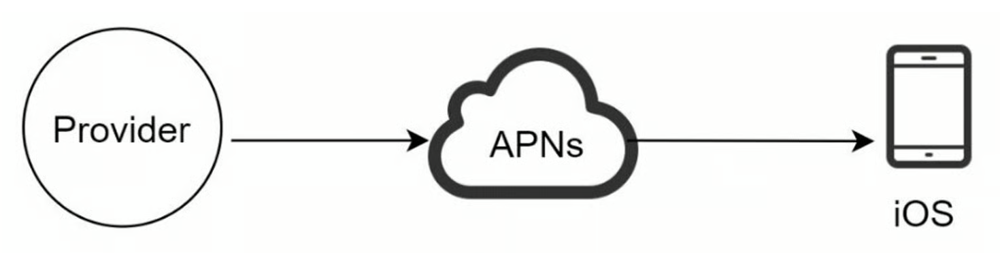
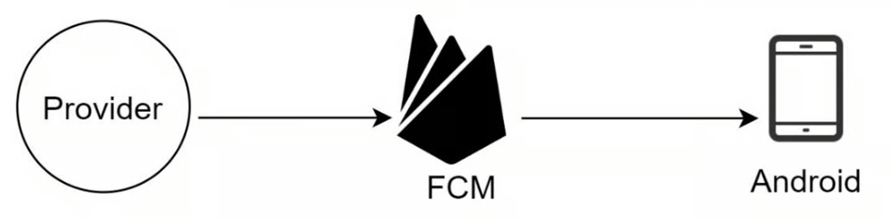
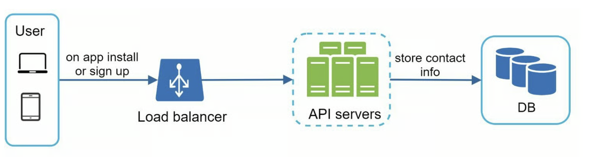
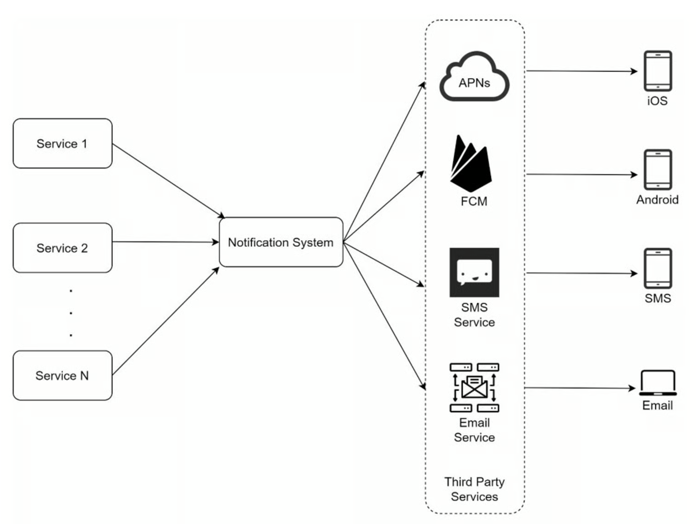
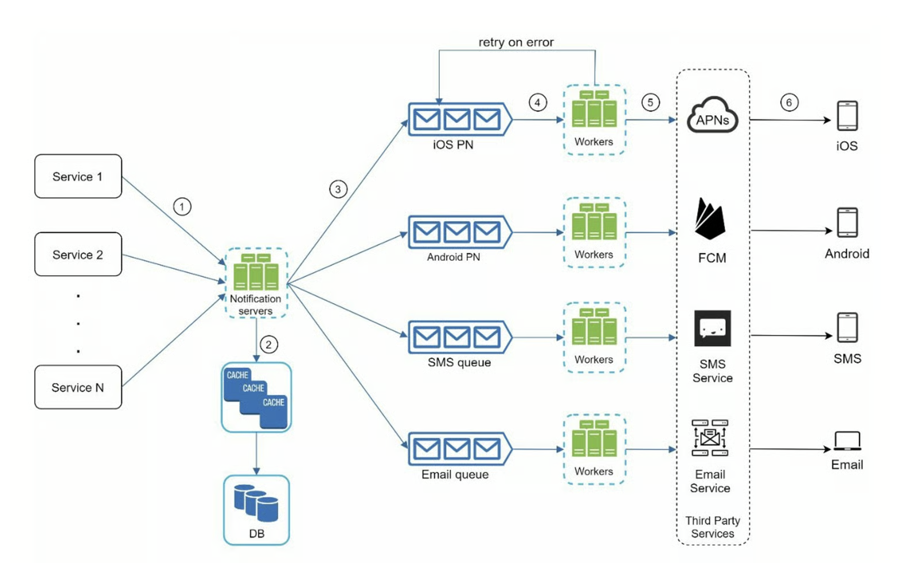
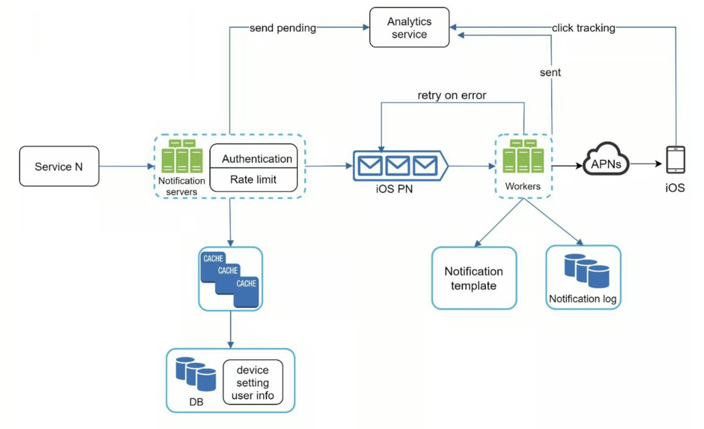

# [設計一個通知系統](https://learning-guide.gitbook.io/system-design-interview/xi-tong-she-ji-mian-shi-nei-mu-zhi-nan-di-yi-juan/chapter-10-design-a-notification-system)

## 1. 通知系統
1. 推播通知 (Push Notification)
2. Email 通知
3. 簡訊通知 (SMS)


## 2. 定義需求

> Q1. 系統支援哪些類型的通知？
>
> A1: 推播通知、簡訊、郵件

> Q2. 它是一個即時的系統嗎
>
> A2: 這是一個軟即時系統。希望用戶能盡快收到通知。但是如果系統處於高負載狀態時，稍有延遲也是可以接受的

> Q3. 支援的設備有哪些？
>
> A3: IOS、Android、筆電、桌機

> Q4. 什麼會觸發通知？
>
> A4: 由客戶端應用程式觸發。也可以由伺服器端

> Q4. 使用者是否能停止接收通知？
>
> A4: 可以

> Q4. 每天發出多少次通知？
>
> A4: 1000 萬條行動推播通知，500 萬封電子郵件，100 萬則簡訊


<!-- TODO: -->
## 3. 粗估系統量級

| 項目 | 假設 / 算式 | 結果 |
| ---- | ----------- | ---- |
| 讀取 QPS | 10 億 ÷ 30 ÷ 24 ÷ 3600 | 約 400 頁/秒 |
| 總筆數 | 跑 10 年 → 10 億 × 12 × 10 | 1,200 億筆 |
| 儲存空間 | 平均網頁大小為 500k → 10 億 × 500k | 500 TB/月, 五年共 30 PB |
| 峰值 QPS | 讀取 QPS × 2～3 | 約 800 頁/秒 |

光是保存抓取的頁面資料，就可能需要約 30 PB 的儲存空間，而且還沒算進索引、備份與其他額外資料。

從這個簡單的估算可以發現，Crawler 的壓力不只是每秒要發送多少 Request，還需要考慮：

- **儲存空間**：抓回來的網頁需要多少容量？
- **網路頻寬**：每秒需要下載多少資料？
- **URL 數量**：大量待抓取的 URL 要如何管理？
- **DNS Latency**：解析網域名稱需要多少時間？
- **Response Time**：外部網站回應太慢，會不會影響抓取速度？
- **重試（Retry）**：抓取失敗的任務要如何重新處理？

## 4. 系統架構拆解
### 4-1. iOS 推播通知

- Provider: 若要建立推播通知，需提供以下資訊：

1. 設備 token：這是用於發送推播通知的唯一識別碼。
2. 有效載荷
```
{
    "aps": {
        "alert": {
            "title": "Game Request",
            "body": "Bob wants to play chess",
            "action-loc-key": "PLAY"
        },
        "badge": 5
    }
}
```
- APNS 蘋果推播通知服務

### 4-2. Android 推播通知


Firebase Cloud Messaging (FCM)


### 4-3. 簡訊
通常會使用第三方提供的 SMS 服務，像是 Twilio、AWS SNS (Simple Notification Service)、Google Cloud Vertex AI/Firebase Auth、Nexmo


💡 系統設計時的關鍵考量

1. 編碼與計費陷阱： SMS 的字數計算非常嚴格。純英文數字（GSM-7 編碼）單則上限 160 字；但只要含有任何一個中文字或全形符號（UCS-2 編碼），單則上限就會變成 70 字。超過會被拆成多則發送並重複計費。
2. 台灣白名單新規（NCC 政策）： 自 2024 年底起，如果簡訊內含有網址、短網址或電話號碼，必須先向簡訊代發商登錄「企業白名單」與對應網域，否則會被電信商直接阻擋。純文字的 OTP 驗證碼則不受影響。
3. 架構解耦 (Asynchronous)： 簡訊發送屬於外部 I/O 呼叫，強烈建議在通知系統內加入 Message Queue（如 RabbitMQ, AWS SQS）走非同步發送，避免簡訊服務商慢速或當機時，拖垮你自己的前端系統。

### 4-4. 郵件
可以設定自己的 mail server，但許多公司會使用第三方提供的電子郵件服務，像是 Sendgrid（已被 Twilio 收購）、Mailchimp 、Amazon SES (Simple Email Service)、

> 補充：
> 有些系統不僅要發 SMS，還需要同時管理 Email、LINE 推播。這類平台提供了一站式的 API 或後台
> 1. 電子豹 (NewsLeopard)
> 2. EngageLab / JPush
> 3. Omnichat / 91APP

### 4-5. 聯絡人資訊收集流程


### 4-6. 通知發送/接收流程


在這個設計中，可能會遇到三個問題：

1. 單點故障（SPOF）：單一通知伺服器意味著 SPOF
2. 難以擴展：通知系統在一台伺服器上處理所有與推播通知有關的事情。要獨立擴展資料庫、快取和不同的通知處理元件是困難的
3. 效能瓶頸

針對以上問題，可以調整一下架構



* Queue：消除了元件之間的依賴性。當大量的通知被發送出去時，Queue 可以作為緩衝區。每種通知類型都被指派了一個不同的 Queue，所以一個第三方服務的中斷不會影響其他通知類型
* Workers：Workers 是一組伺服器，從 Queue 中拿取通知事件，並將它們送到對應的第三方服務

## 5. 深入設計


<details>
  <summary>可靠性</summary>

  1. 資料不能遺失 -> 將通知資料持久化到資料庫中，並實作重試機制
  2. 分散式系統有可能造成通知重複發 -> 重複資料刪除機制並處理每個失敗案例>
  > 刪除邏輯：當一個通知事件第一次到達時，透過檢查事件 ID 判斷是否出現過。如果出現過，就將它丟棄。否則，將發送通知

  > 為什麼去重只能「減少」重複，無法完全避免？
  >
  > 在分散式系統中，「剛好送達一次（exactly-once delivery）」是做不到的。因為 Sender 送出訊息後，如果 ACK 在網路上遺失，Sender 無法分辨是「訊息沒送到」還是「送到了只是 ACK 掉了」。Receiver 端也有同樣的問題：
  >
  > 以通知系統為例（Sender = Queue、Receiver = Worker、處理 = 呼叫第三方服務發出通知、ACK = 告訴 Queue 可以刪除這則）：
  > - 先 ACK 再處理：Worker 回 ACK 後、呼叫第三方服務前當機 → Queue 已刪除這則，不會重送 → 通知遺失
  > - 先處理再 ACK：Worker 已透過第三方服務發出通知、回 ACK 前當機 → Queue 以為沒處理，交給其他 Worker 重送 → 收到重複通知

  >
  > | 語意 | 做法 | 結果 |
  > |---|---|---|
  > | At-most-once（最多一次） | 送了就不管，不重試 | 可能遺失，不會重複 |
  > | At-least-once（至少一次） | 沒收到 ACK 就重試 | 不會遺失，可能重複 |
  >
  > 通知系統選擇 At-least-once delivery + 冪等（idempotent）處理 / 去重（寧可重送也不能漏發），再用事件 ID 去重。但像「通知已送出、還沒記錄事件 ID 就當機」這種情況，重試時還是會重複發送，所以去重只能降低重複，無法完全避免。


</details>


<details>
  <summary>其他元件和考慮因素</summary>

  1. 通知模板：
     一個大型系統每天會發出很多則通隻，其中有些的格式是很類似的，給定一個預先格式化的通知，透過自訂參數、樣式、追蹤連結等來建立
  2. 通知設定
     使用者可以關閉通知，網站可以透過通知設定 table 去查看，當前使用者是否有選擇接收這種類型的通知
     ```
     user_id   bigInt
     channel  varchar    # push notification, email or SMS
     opt_in   boolean    # opt-in to receive notification
     ```
  3. 速率限制 rate limiting
     保護使用者不被過多的通知淹沒，可以限制用戶收到的通知的數量
  4. 重試機制：
     處理通知失敗的情況，失敗的話會被放回訊息佇列中，workers 會重試預定的次數，如果重試後問題持續存在，就通知開發者
  5. 推播通知的安全性問題
     對於iOS 或 Android，appKey 和 appSecret 被用來保護推播通知API。只有經過認證或驗證的用戶端才允許使用 API 發送推播通知

     > 實際做法（以 IBM MobileFirst 為例）
     >
     > 呼叫推播 API 時，用戶端必須帶一個 **有效的 access token**，且 token 要有 **對應的權限範圍（scope）**。
     >
     > | 用戶端 | 取得 token 的方式 |
     > |---|---|
     > | 行動 App | SDK 自動跑 OAuth 流程，App 不用自己處理 |
     > | 後端伺服器 | 先註冊成 **confidential client**（拿到 client ID / secret，也就是 appKey / appSecret），再自己跑 OAuth 流程向授權伺服器換 token |
     >
     > Scope 切得很細，讀/寫分開：
     > - `messages.write`：發送推播通知
     > - `devices.read / write`：讀取或管理已註冊的裝置
     > - `subscriptions.read / write`：讀取或管理訂閱
     > - `apnsConf.read / write`、`smsConf.read / write`：讀取或修改 APNs、SMS 等第三方服務的設定（例如 API key）
     >
     > 重點：
     > 1. appKey / appSecret 是用來 **換 token** 的憑證，呼叫推播 API 時帶的是 token，不是直接帶 secret
     > 2. 依照 **最小權限原則** ，例如只負責發通知的後端服務只給 `messages.write`，就無法修改 APNs 金鑰
  6. 監控排隊通知
     監控的關鍵指標：**排隊通知的總數**，如果數字很大，表示 workers 處理速度不夠快。為了避免通知的延遲，需要更多 workers
  7. 事件追蹤(了解客戶行為)：需要通知系統和分析服務間的整合

</details>

## 6. 完整架構



## 7. 參考資料

- [20261109 第 53 次分享](https://app.notion.com/p/20261109-53-407dcde4e6438077bbdaf107fb91269e?v=6b5636e24d0842759cdf042401dfb544&source=copy_link)
- [Twilio SMS](https://www.twilio.com/sms)
- [Nexmo SMS](https://www.nexmo.com/products/sms)
- [Sendgrid](https://sendgrid.com/)
- [Mailchimp](https://mailchimp.com/)
- [You Cannot Have Exactly-Once Delivery](https://bravenewgeek.com/you-cannot-have-exactly-once-delivery)
- [Security in Push Notifications](https://www.ibm.com/docs/en/mpf/8.0.0?topic=notification-security-push-clients)
- [RabbitMQ](https://bit.ly/2sotIa6)
