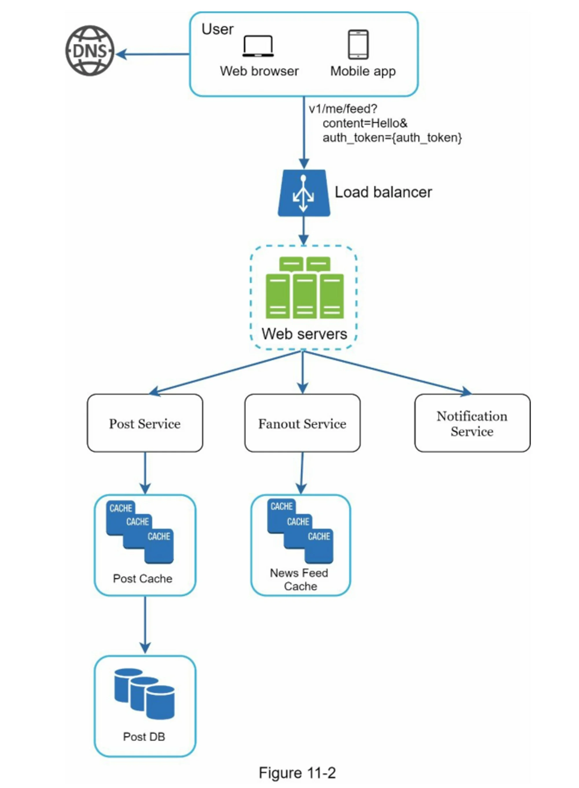
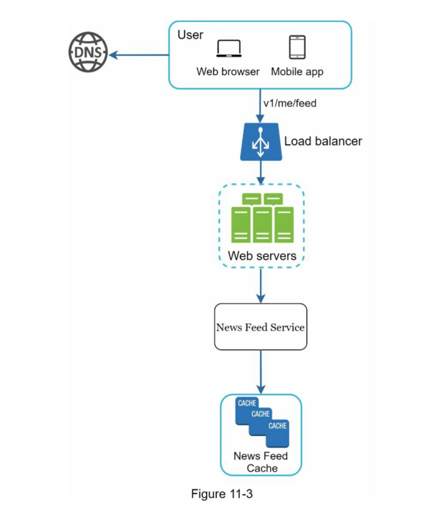
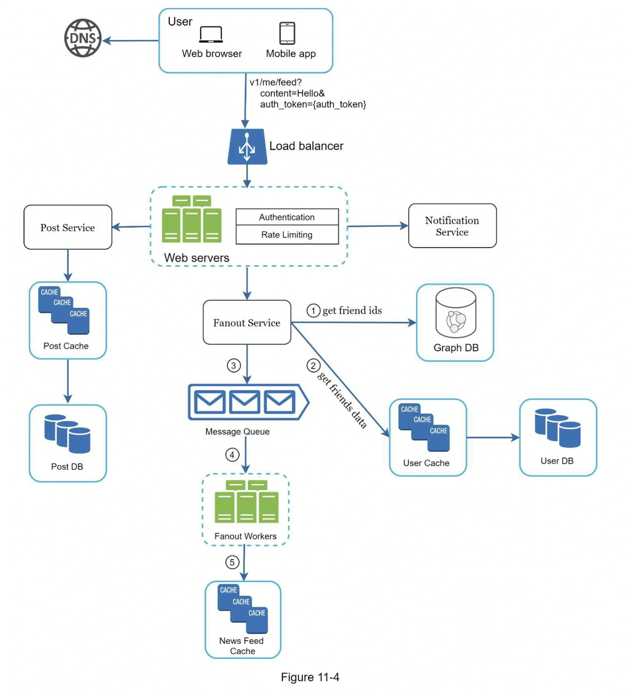
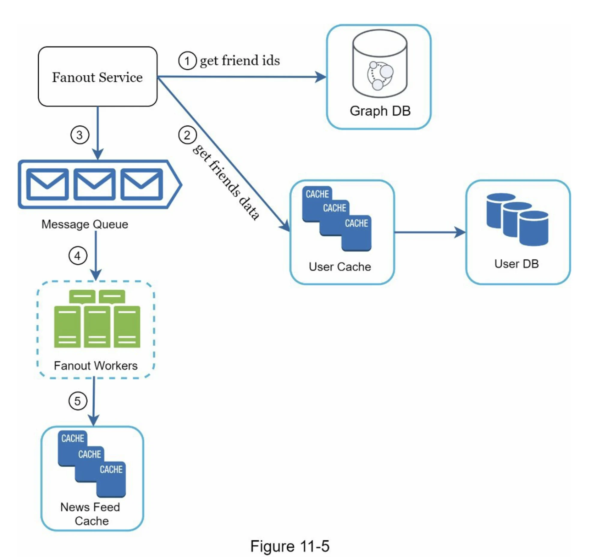
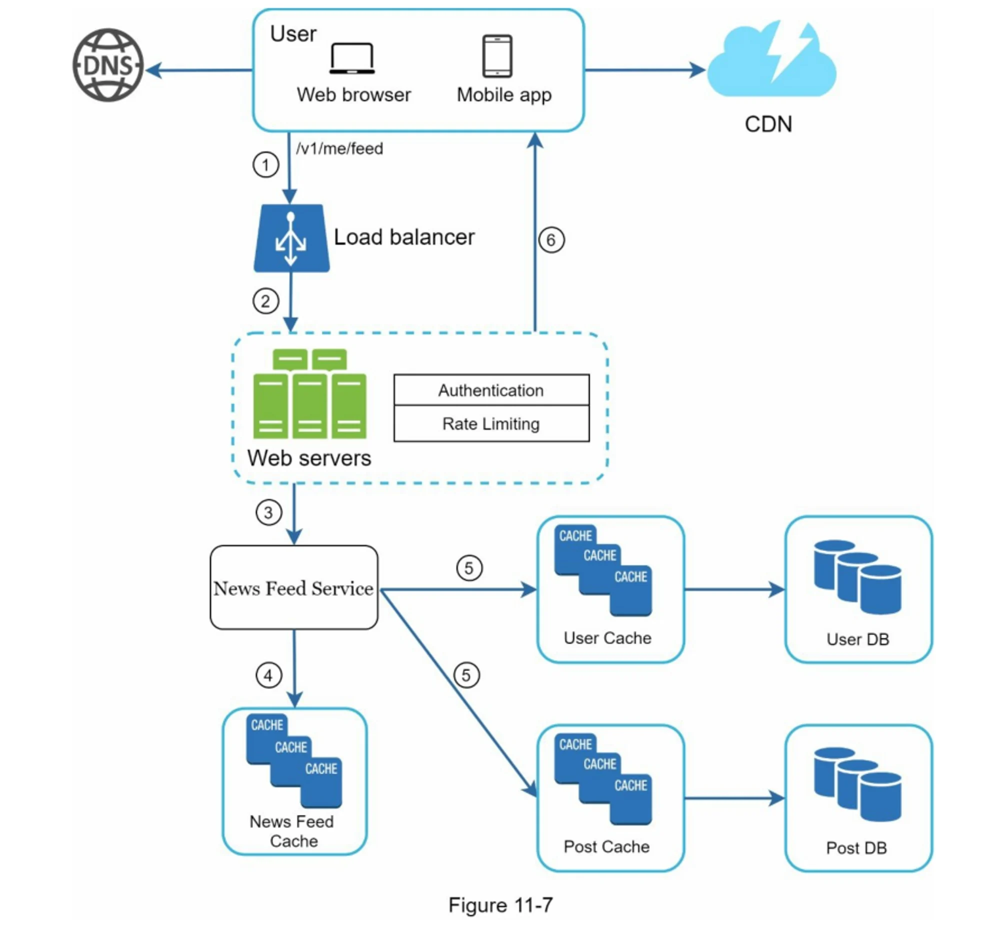
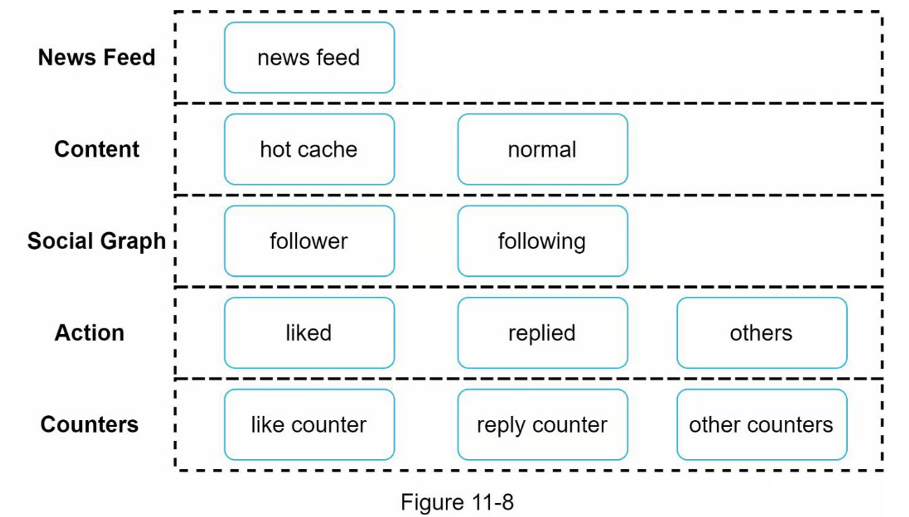

# [設計一個新聞提要系統（資訊推送系統）](https://learning-guide.gitbook.io/system-design-interview/xi-tong-she-ji-mian-shi-nei-mu-zhi-nan-di-yi-juan/chapter-11-design-a-news-feed-system)


## 1. 資訊推送
## 2. 定義需求

> Q1. 這是行動應用程式還是網頁應用？或兩者都是？
>
> A1: 兩者都是

> Q2. 有哪些重要功能？
>
> A2: 使用者可以發布貼文，並在資訊流頁面上看到朋友的貼文

> Q3. 資訊流是按時間倒序排序，還是依特定順序（如主題分數）？例如親密朋友的貼文分數較高
>
> A3: 為了簡單起見，假設依時間倒序排序

> Q4. 一個使用者可以有多少個朋友？
>
> A4: 5000 個

> Q5. 流量有多大？
>
> A5: 1000 萬 DAU(Daily Active Users)

> Q6. 貼文可以包含圖片、影片，還是只有文字？
>
> A6: 可以包含媒體檔案，包括圖片和影片

## 3. 粗估系統量級

> 書中未提供估算，以下數字為自行假設

| 項目 | 假設 / 算式 | 結果 |
| ---- | ----------- | ---- |
| 讀取 QPS | 每人每天看 10 次資訊流 → 1000 萬 × 10 ÷ 86400 秒 | 約 1,160 QPS |
| 發文 QPS | 每人每天發 1 篇貼文 → 1000 萬 × 1 ÷ 86400 秒 | 約 116 QPS |
| 峰值 QPS | 平均 QPS × 2～3 | 讀取約 3,500 / 發文約 350 |
| 扇出寫入量（推模式） | 每篇貼文最多推給 5000 位朋友 → 116 × 5000 | 最壞約 58 萬次寫入/秒 |

從扇出寫入可以看出，壓力不只在讀取資訊流，「把一篇貼文送到所有朋友的資訊流」才是設計上的重點。

扇出（Fan-out）：一個動作要擴散到很多目標。在資訊流系統裡，就是將貼文傳遞給所有朋友的過程，1 次發文最多會變成 5000 次寫入

| 項目 | 推模式（Fan-out on write） | 拉模式（Fan-out on read） |
| ---- | -------------------------- | ------------------------- |
| 時機 | 發文時就寫進所有朋友的資訊流快取中 | 朋友打開資訊流時才去抓 |
| 優點 | 讀取速度快，打開就有現成的資訊流 | 不浪費寫入，不活躍的使用者不用算，沒有熱鍵問題 |
| 缺點 | 朋友很多的人（名人）發文時寫入量爆炸（熱鍵問題）、不活躍或很少登入的用戶會浪費計算資源 | 讀取慢，每次都要即時組資訊流 |
| 適合對象 | 一般使用者 | 名人（粉絲很多的帳號） |

實務上通常兩種混用：一般使用者用推模式，名人用拉模式

## 4. 系統架構拆解

分成兩種流程：
- 資訊發佈（Feed publishing）：當使用者發文時，資訊會寫入快取和資料庫
- 資訊流建置（Newsfeed building）：假設資訊發佈是按照「時間倒序」聚合朋友的貼文來建構的

### 4.1 資訊發佈的 API

- `POST /v1/me/feed`

> 參數：
> content 貼文的內容

- `GET /v1/me/feed`

### 4.2 資訊發佈（Feed publishing）



### 4.3 資訊流建置（Newsfeed building）


## 5. 深入設計

### 5.1 資訊發佈（Feed publishing）


### 5.2 web servers
除了與用戶端通訊外，Web 伺服器還執行身份驗證和 Rate Limiting，限制用戶在一定時期內可以發布的貼文數量

### 5.3 Fan-out 扇出服務


- 寫扇出（推模式）：一個新的貼文在發布後會立即被送到朋友的快取中，會有熱鍵問題 -> 靠一致性雜湊解決
- 讀扇出（拉模式）：當用戶加載主頁時，最新的貼文被拉出

#### 5.3.1 扇出流程

1. 從 Graph DB 拿到發文者的朋友 ID 清單
2. 從 User Cache / User DB 拿朋友的設定，過濾掉不該收到的人（例如把發文者靜音、不在貼文分享名單內）
3. 把「朋友 ID 清單 + post_id」丟進 Message Queue
4. Fanout Workers 從 Queue 取出，把 `<post_id, user_id>` ，`user_id` 是**發文者**的 ID，讀取時用來查作者名字和頭像，寫進每位朋友的 News Feed Cache

> 朋友關係是「點和線」的結構，用 Graph DB 查「朋友的朋友」「共同好友」比關聯式資料庫一層層 JOIN 快很多

#### 5.3.2 News Feed Cache 設計細節

快取只存 ID，不存整篇貼文

| 項目 | 說明 |
| ---- | ---- |
| 只保留最近 N 筆 | 使用者通常只看最新的內容，舊的就從快取移除，控制記憶體用量 |
| 寫入方式 | 發文後丟進 Message Queue，由 Fanout Workers 非同步寫進每位朋友的快取，發文者不用等 |

### 5.4 資訊來源檢索深入研究


讀取資訊流的流程：
1. 從 News Feed Cache 資訊流快取 拿到 post_id 清單
2. 用 post_id 去 Post Cache 拿貼文內容
3. 用 user_id 去 User Cache 拿作者名字、頭像
4. 組成完整的資訊流回傳

> Cache miss：快取裡沒有的（太舊或被清掉）就從資料庫查。大多用戶只對最新內容感興趣，所以 Cache miss rate 低


### 5.4.1 快取架構

將快取層分為 5 層：


- News Feed：儲存貼文 ID（`<post_id, user_id>`）
- Content：儲存每個貼文的內容。受歡迎的內容被儲存在 Hot Cache 中
- Social Graph：儲存用戶關係資料
- Action：儲存有關用戶是否喜歡貼文、回覆貼文或對貼文執行其他動作的資訊
- Counters：儲存按讚、回覆、追蹤者、追蹤等的計數器

## 5. 延伸

書中為了簡單起見，假設資訊發佈是按照「時間倒序」聚合朋友的貼文來建構，但真實產品多半預設依個人化排序（如互動預測、關係親密度、新鮮度）

> 以下為業界常見做法

Facebook、Instagram 會記錄**停留時間（Dwell time）**，當作排序訊號：使用者在某類貼文停留越久，演算法就越常推這類內容

```
流程：

Client 端偵測停留時間 → 批次送出事件 → Kafka 等 Message Queue → 資料倉儲（Data Warehouse or Data Lake, ex, BigQuery, Snowflake, S3, Hive） / 分析系統 → 訓練排序模型
```

如果需求改成「依興趣排序」，就要另外設計這套事件收集和排序系統

### 5.1 RabbitMQ v.s. Kafka

- RabbitMQ：傳統的訊息佇列，把每則訊息交給某個消費者處理，處理完就刪掉
- Kafka：分散式事件日誌，大量、依序保存事件，讓多個系統各自讀取

| 項目 | RabbitMQ | Kafka |
| ---- | -------- | ----- |
| 訊息被讀走後 | 確認處理完就刪除 | 保留一段時間，不會因為讀過就刪 |
| 多個系統要讀同一份資料 | 要另外設定複製到多個佇列 | 各自用自己的 offset 讀，互不影響 |
| 可以重讀舊資料嗎 | 不行，刪了就沒了 | 可以，把 offset 往回調就能重跑 |
| 吞吐量 | 中高（每秒數萬筆） | 非常高（每秒數十萬到百萬筆） |
| 路由彈性 | 很強，可依規則把訊息分到不同佇列 | 較簡單，主要靠 topic 和 partition |
| 適合場景 | 任務分派、工作佇列 | 事件收集、日誌、資料管線、串流分析 |

停留時間事件量大、會被多個系統使用（排序模型、報表、A/B 測試），也可能需要重跑，所以適合用 Kafka

## 6. 小試身手


**Q1. 推模式和拉模式各有什麼優缺點？實務上怎麼取捨？**

<details>
<summary>答案</summary>

- 推模式：發文時就寫進朋友的快取，讀取快；但名人發文寫入量爆炸（熱鍵問題），也會浪費在不活躍用戶身上
- 拉模式：讀取時才組資訊流，不浪費寫入；但讀取慢
- 實務上混用：一般使用者用推模式，名人用拉模式
</details>

---

**Q2. 扇出服務如何拿到要推送的朋友清單？推送前還要做什麼？**

<details>
<summary>答案</summary>

從 Graph DB 取得朋友 ID 清單，再從 User Cache / User DB 拿朋友的設定，過濾掉把發文者靜音、或不在分享名單內的人
</details>

---

**Q3. News Feed Cache 裡存的是什麼？為什麼不直接存整篇貼文？**

<details>
<summary>答案</summary>

只存 `<post_id, user_id>`，其中 `user_id` 是發文者的 ID。若每位朋友都存完整內容，5000 位朋友就要複製 5000 份，記憶體很快就會用完
</details>

---

**Q4. 為什麼 Fanout Workers 要透過 Message Queue 非同步處理？**

<details>
<summary>答案</summary>

發文者不用等 5000 次寫入完成才收到回應，寫入工作可以交給多個 Worker 分散處理
</details>

---

**Q5. 情境題：一位擁有 5000 萬粉絲的明星剛發了一篇貼文。幾分鐘後，Fanout Workers 的 Queue 大量堆積，一般使用者也開始抱怨「朋友剛發的貼文刷不出來」。請說說你會怎麼改設計？**

<details>
<summary>答案</summary>

**發生了什麼**

系統對所有人都用推模式。明星的 1 篇貼文要寫進 5000 萬個 News Feed Cache，把 Queue 和 Workers 都塞滿了，一般使用者的貼文排在後面，遲遲寫不進朋友的快取

**怎麼改**

1. 改成混合模式：粉絲數超過門檻的帳號（名人）不做推模式，發文時只寫入 Post Cache / DB
2. 讀取時合併：使用者打開資訊流時，從 News Feed Cache 拿到朋友推來的 post_id，再去拉自己追蹤的名人最新貼文，合併後依時間倒序排序
3. 熱門內容快取：名人的貼文會被大量讀取，放進 Content 層的 Hot Cache，避免同一篇貼文的讀取都打到同一台機器
4. 分開 Queue（加分）：名人和一般使用者的扇出任務分到不同的 Queue 或 Kafka Topic

**追問：門檻要設多少？**

沒有標準答案。可以依粉絲數設定（例如 10 萬），也可以依「扇出成本」動態判斷。另外還要考慮粉絲中有多少是活躍用戶，寫入不活躍粉絲的快取是浪費
</details>
