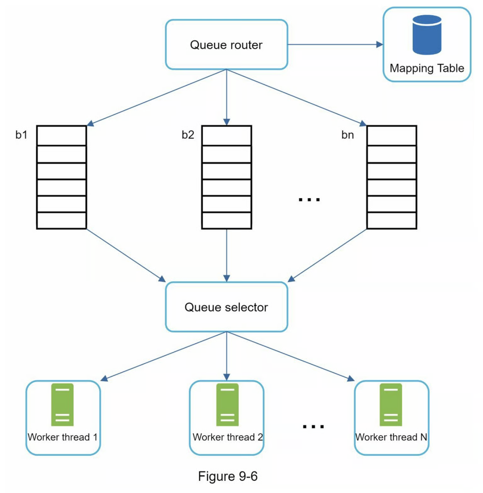
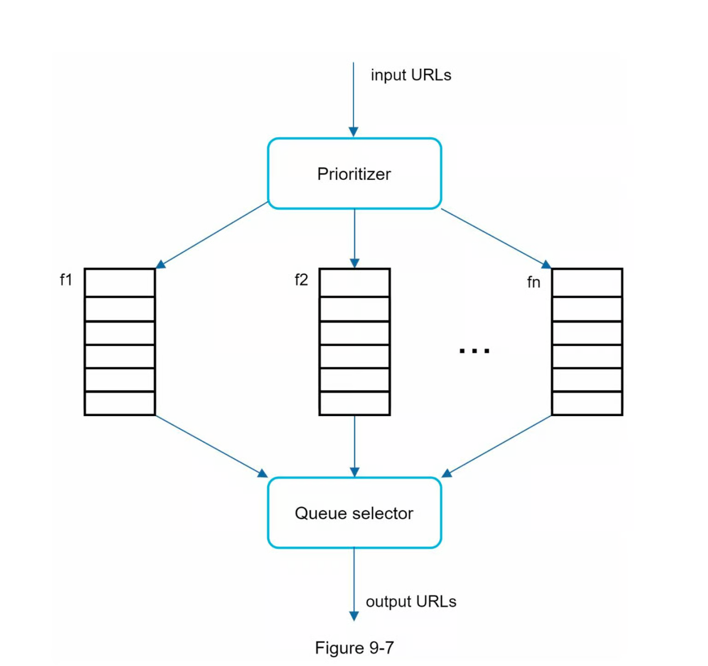

# [網路爬蟲系統設計](https://learning-guide.gitbook.io/system-design-interview/xi-tong-she-ji-mian-shi-nei-mu-zhi-nan-di-yi-juan/chapter-09-design-a-web-crawler)

## 1. 設計前的知識科普：

> 網路爬蟲（Web Crawler or Web Spider），是一種自動化程式或機器人，用來在網路上自動瀏覽網頁並收集資料，爬取內容可以是網頁、圖片、PDF、影片、JSON 等。許多網站會在根目錄設置 `robots.txt` 檔案，用來規範哪些頁面允許爬蟲訪問、哪些不行。

### 1.1 應用層面
* 搜尋引擎索引：Googlebot(Google 搜尋引擎背後的網路爬蟲)，最常見
* 網路監控：監控侵權行為
* 資料挖掘：在網路中爬取有用的知識，例如：租屋資訊、股東大會報告等
* 資料存取：有些國家圖書管會用爬蟲來存取網站，保存不同時間的版本，當成歷史文獻，供現在與未來的研究者使用

### 1.2 運作流程


### 1.3 元件設計
| 元件 | 中文意思 | 負責做什麼 |
|---|---|---|
| **Seed URLs** | 起始網址，爬蟲的起點 | 提供起始點，例如新聞網站首頁，一般是將整個 URL 拆成更小單位，像是基於位置、主題(購物、體育等) |
| **URL Frontier** | 待爬網址與排程 | 儲存待下載的 URL，以及先抓哪個，可稱為 FIFO 佇列 |
| **HTML Downloader** | HTML 下載器 | 發出 HTTP 請求，下載網頁，URL 是由URL Frontier 提供的 |
| **DNS Resolver** | DNS 解析器 | 將網域名稱轉成 IP，讓下載器找到伺服器 |
| **Content Parser** | 內容解析器 | 解析下載回來的 HTML，供後續處理 |
| **Content Seen?** | 內容是否重複？ | 判斷是否已經蒐集過相同內容 |
| **Content Storage** | 內容儲存區 | 保存抓到的網頁內容，大部分內容儲存在磁碟上，因資料集太大而無法放入記憶體; 熱門內容則保存在記憶體中以減少延遲 |
| **URL Extractor** | 網址擷取器 | 從 HTML 頁面解析並擷取網址 |
| **URL Filter** | 網址過濾器 | 排除某些內容類型、檔案副檔名、錯誤連結和「黑名單」網站中的 URL |
| **URL Seen?** | 網址是否已發現？ | 避免同一個網址重複加入待爬清單 |
| **URL Storage** | 網址儲存區 | 記錄已發現的網址，供去重查詢 |


### 1.3 好的爬蟲基本樣貌
* 限制並行數，除了提升速度，也避免請求過多
* 失敗處理
* 只需進行最少的變更即可支援新的內容類型（可擴充性）
* 遵守爬取規範，像是 `robots.txt`、網站規範、請求頻率限制

## 2. 定義需求

> Q1. 爬蟲的主要目的是什麼？它用於搜尋引擎索引、資料探勘或其他用途嗎？
>
> A1: 搜尋引擎索引

> Q2. 網路爬蟲每個月收集多少網頁？
>
> A2: 10 億頁

> Q3. 內容包括哪些類型？
>
> A3: 只有 HTML

> Q4. 爬蟲抓過網站之後，還需要持續追蹤網站後來新增的頁面，以及舊頁面的內容更新嗎？
>
> A4: 是的，我們應該考慮新新增或編輯的網頁。

> Q4. 我們需要存爬取的 HTML 頁面嗎？
>
> A4: 是的，最多 5 年。

> Q4. 我們如何處理內容重複的網頁？
>
> A4: 重複內容的頁面應該忽略。


## 3. 粗估系統量級

> 目的：算出大概的流量與資料量，數量級對就好，並用結果推導設計決策

| 項目 | 假設 / 算式 | 結果 |
| ---- | ----------- | ---- |
| 讀取 QPS | 10 億 ÷ 30 ÷ 24 ÷ 3600 | 約 400 頁/秒 |
| 總筆數 | 跑 10 年 → 1 億 × 365 × 10 | 3,650 億筆 |
| 儲存空間 | 平均網頁大小為 500k → 10 億 × 500k | 500 TB/月, 3五年共 30 PB |
| 峰值 QPS | 讀取 QPS × 2～3 | 約 800 頁/秒 |

設計推導：

<!-- | 估算結果 | 設計決策 |
| -------- | -------- |
| 3,650 億筆 | 短碼長度：62⁶ ≈ 568 億不夠，62⁷ ≈ 3.5 兆 → **至少 7 碼** |
| 讀取尖峰約 3.5 萬次/秒 | 單台 DB 扛不住，需要快取（Redis）與讀取副本 |
| 寫入約 1,160 次/秒 | 單一 DB 可應付，但要注意 ID 產生器的速度 |
| 36.5 TB | 單台機器放不下，需要分片（sharding） | -->


## 4. 深入設計


<details>
  <summary>深度優先搜尋(DFS) 與廣度優先搜尋(BFS)</summary>

BFS 通常被網路爬蟲使用，並透過先進先出(FIFO) 佇列實現。DFS 則因為深度可能到很深，所以並不是個好選擇。

但使用 BFS 可能會遇到幾個問題：
1. 來自同一網頁的大多數連結都連回同一主機。使得爬蟲忙於處理來自同一主機（ex. wikipedia.com）的 URL。當爬蟲試圖並行下載網頁時，維基百科伺服器將被請求淹沒，這被稱為是「不禮貌」。

2. 標準的 BFS 沒有考慮到一個 URL 的優先排序，並不是所有頁面都同等重要。

</details>

URL Frontier

URL Frontier 是確保 URL 優先順序、禮貌性的重要元件。

* 禮貌性
網路爬蟲應該「避免」在短時間內向同一個託管伺服器發送過多的請求。發送過多請求會被視為「不禮貌」，甚至被視為拒絕服務(DOS) 攻擊。

> 強制禮貌：是一次從同一台主機下載一個頁面。可以在兩個下載任務之間新增延遲。禮貌約束是透過維護從網站主機名稱到下載（工作）執行緒的映射來實現的。每個下載執行緒都有一個單獨的 FIFO 佇列，並且只下載從該佇列中取得的 URL。



* 優先權
可以透過PageRank、網站流量、更新頻率等來衡量優先權。


* 新鮮度


HTML Downloader

穩健性（Robustness）

可擴充性（Extensibility）

檢測並避免有問題的內容

## 5. 完整架構

```mermaid

```


## 6. 面試 Q&A