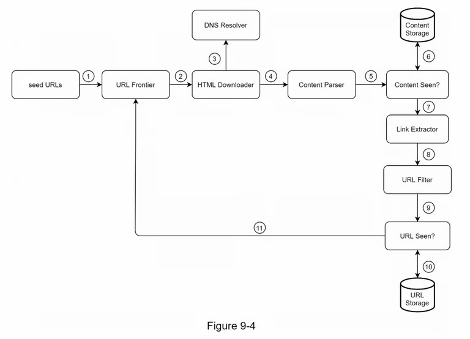
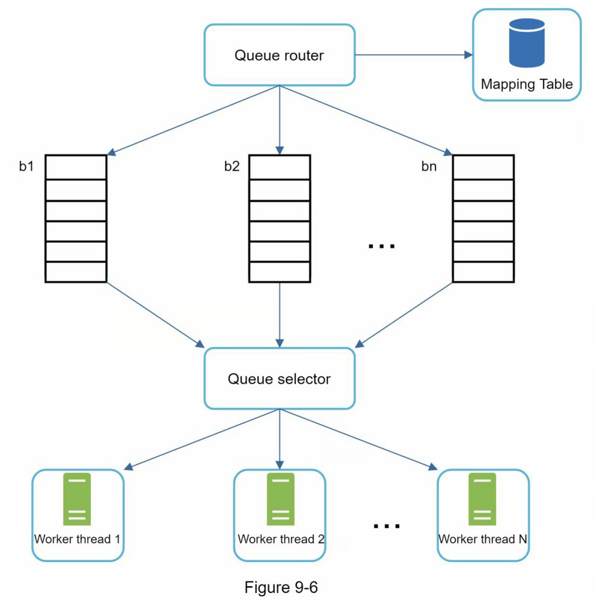
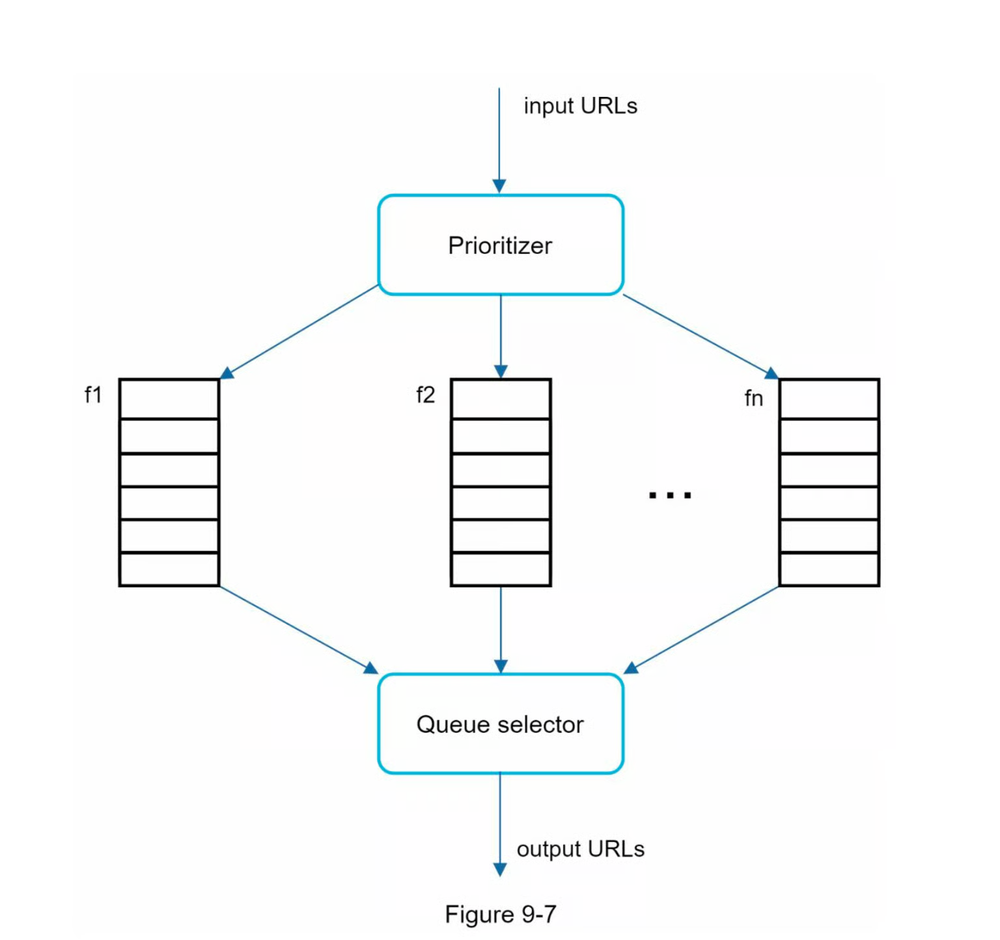
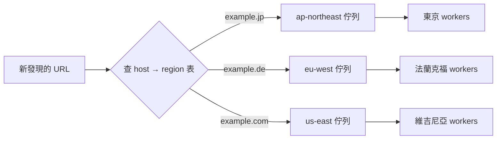
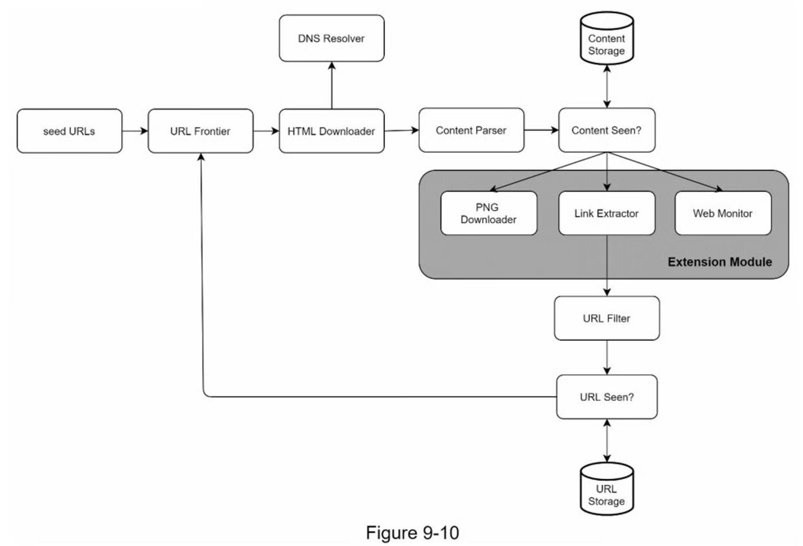
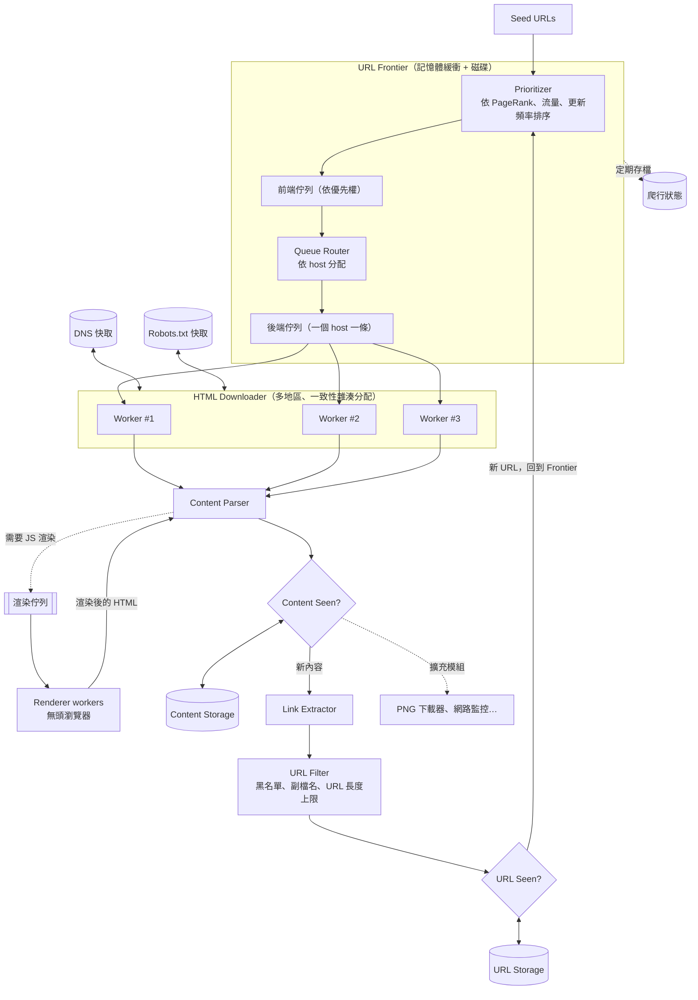

# [網路爬蟲系統設計](https://learning-guide.gitbook.io/system-design-interview/xi-tong-she-ji-mian-shi-nei-mu-zhi-nan-di-yi-juan/chapter-09-design-a-web-crawler)

## 1. 設計前的知識科普：

> 網路爬蟲（Web Crawler or Web Spider），是一種自動化程式或機器人，用來在網路上自動瀏覽網頁並收集資料，爬取內容可以是網頁、圖片、PDF、影片、JSON 等。許多網站會在根目錄設置 `robots.txt` 檔案，用來規範哪些頁面允許爬蟲訪問、哪些不行。

### 1.1 應用層面
* 搜尋引擎索引：Googlebot(Google 搜尋引擎背後的網路爬蟲)，最常見
* 網路監控：監控侵權行為
* 資料挖掘：在網路中爬取有用的知識，例如：租屋資訊、股東大會報告等
* 資料存取：有些國家圖書管會用爬蟲來存取網站，保存不同時間的版本，當成歷史文獻，供現在與未來的研究者使用

### 1.2 運作流程



### 1.3 元件設計
| 元件 | 中文意思 | 負責做什麼 |
|---|---|---|
| **Seed URLs** | 起始網址，爬蟲的起點 | 提供起始點，例如新聞網站首頁，一般是將整個 URL 拆成更小單位，像是基於位置、主題(購物、體育等) |
| **URL Frontier** | 待爬網址與排程 | 儲存待下載的 URL，以及先抓哪個，可稱為 FIFO 佇列 |
| **HTML Downloader** | HTML 下載器 | 發出 HTTP 請求，下載網頁，URL 是由URL Frontier 提供的 |
| **DNS Resolver** | DNS 解析器 | 將網域名稱轉成 IP，讓下載器找到伺服器 |
| **Content Parser** | 內容解析器 | 解析下載回來的 HTML，供後續處理 |
| **Content Seen?** | 內容是否重複？ | 判斷是否已經蒐集過相同內容 |
| **Content Storage** | 內容儲存區 | 保存抓到的網頁內容，大部分內容儲存在磁碟上，因資料集太大而無法放入記憶體; 熱門內容則保存在記憶體中以減少延遲 |
| **URL Extractor** | 網址擷取器 | 從 HTML 頁面解析並擷取網址 |
| **URL Filter** | 網址過濾器 | 排除某些內容類型、檔案副檔名、錯誤連結和「黑名單」網站中的 URL |
| **URL Seen?** | 網址是否已發現？（去重） | 避免同一個網址重複加入待爬清單 |
| **URL Storage** | 網址儲存區 | 記錄已發現的網址，供去重查詢 |


### 1.3 好的爬蟲基本樣貌
* 限制並行數，除了提升速度，也避免請求過多
* 失敗處理
* 只需進行最少的變更即可支援新的內容類型（可擴充性）
* 遵守爬取規範，像是 `robots.txt`、網站規範、請求頻率限制

## 2. 定義需求

> Q1. 爬蟲的主要目的是什麼？它用於搜尋引擎索引、資料探勘或其他用途嗎？
>
> A1: 搜尋引擎索引

> Q2. 網路爬蟲每個月收集多少網頁？
>
> A2: 10 億頁

> Q3. 內容包括哪些類型？
>
> A3: 只有 HTML

> Q4. 爬蟲抓過網站之後，還需要持續追蹤網站後來新增的頁面，以及舊頁面的內容更新嗎？
>
> A4: 是的，我們應該考慮新新增或編輯的網頁。

> Q4. 我們需要存爬取的 HTML 頁面嗎？
>
> A4: 是的，最多 5 年。

> Q4. 我們如何處理內容重複的網頁？
>
> A4: 重複內容的頁面應該忽略。


## 3. 粗估系統量級

> 目的：算出大概的流量與資料量，數量級對就好，並用結果推導設計決策

| 項目 | 假設 / 算式 | 結果 |
| ---- | ----------- | ---- |
| 讀取 QPS | 10 億 ÷ 30 ÷ 24 ÷ 3600 | 約 400 頁/秒 |
| 總筆數 | 跑 10 年 → 10 億 × 12 × 10 | 1,200 億筆 |
| 儲存空間 | 平均網頁大小為 500k → 10 億 × 500k | 500 TB/月, 五年共 30 PB |
| 峰值 QPS | 讀取 QPS × 2～3 | 約 800 頁/秒 |


## 4. 深入設計


<details>
  <summary>深度優先搜尋(DFS) 與廣度優先搜尋(BFS)</summary>

BFS 通常被網路爬蟲使用，並透過先進先出(FIFO) 佇列實現。DFS 會順著連結一直往下鑽，容易卡在同一個網站裡出不來（甚至掉進蜘蛛陷阱），所以並不是個好選擇。

但使用 BFS 可能會遇到幾個問題：
1. 來自同一網頁的大多數連結都連回同一主機。使得爬蟲忙於處理來自同一主機（ex. wikipedia.com）的 URL。當爬蟲試圖並行下載網頁時，維基百科伺服器將被請求淹沒，這被稱為是「不禮貌」。

2. 標準的 BFS 沒有考慮到一個 URL 的優先排序，並不是所有頁面都同等重要。

</details>

<details>
  <summary>URL Frontier</summary>

URL Frontier 是確保 URL 優先順序、禮貌性的重要元件。

* 禮貌性
網路爬蟲應「避免」在短時間內向同一個託管伺服器發送過多的請求。發送過多請求會被視為「不禮貌」，甚至被視為拒絕服務(DOS) 攻擊。

> 強制禮貌：是一次從同一台主機下載一個頁面。可以在兩個下載任務之間新增延遲。禮貌約束是透過維護從網站主機名稱到下載（工作）執行緒的映射來實現的。每個下載執行緒都有一個單獨的 FIFO 佇列，並且只下載從該佇列中取得的 URL。



* 優先權
可以透過 PageRank、網站流量、更新頻率等來衡量優先權。


* 前端佇列 vs 後端佇列

| | 前端佇列（Front Queues） | 後端佇列（Back Queues） |
|---|---|---|
| 解決的問題 | 優先權：重要的先抓 | 禮貌性：別把同一個網站打爆 |
| 怎麼分 | 依優先度分（高、中、低各一條） | 依 host 分（一個網站一條） |
| 誰放進來 | Prioritizer 依 PageRank、流量、更新頻率算分數，放進對應優先度的佇列 | Queue Router 查「host → 佇列」映射表，放進該 host 的佇列 |
| 怎麼取出 | 優先度高的佇列被挑中的機率比較高 | 每條佇列只由一個 worker 依序下載，兩次下載之間加延遲 |

> 為什麼後端佇列要一個 host 一條？
>
> 因為每條佇列只由「一個」worker 依序處理，所以同一個網站在同一時間最多只有一個請求，不會同時被好幾個 worker 打；worker 也能在兩次下載之間加上延遲，控制請求速率。
> 如果多個網站混在同一條佇列，或同一個網站分散在多條佇列，就沒辦法保證「同一時間只打它一次」。

* 新鮮度
網頁是會不斷更新的，爬蟲需要定期重新抓取下頁面的內容保持資料是最新的狀態，但重新抓取所有 URL 好耗時又耗費資源，有以下幾種優化新鮮度的方法：

1. 根據網頁更新歷史重新抓取
2. 對 URL 進行優先排序，針對優先度高的頻繁抓取。


* URL Frontier 存儲
URL 的數量可能是非常龐大的，存在記憶體中不實際也不好擴展，也不該都放在磁碟，因為磁碟的讀取速度很慢。這裡採用「混合做法」，大多數 URL 放在磁碟上，在記憶體中維護緩衝區以進行入隊、出隊操作。緩衝區的資料會定期寫入磁碟。

</details>

<details>
  <summary>HTML Downloader</summary>

* Robots.txt
`Robots.txt` 稱為Robots 排除協議，是網站用來與爬蟲溝通的標準。規定爬蟲可以下載哪些頁面，範例：

creatorhub 是不允許 google bot 訪問的。
```
User-agent: Googlebot
Disallow: /creatorhub/*
Disallow: /rss/people/*/reviews
Disallow: /gp/pdp/rss/*/reviews
Disallow: /gp/cdp/member-reviews/
Disallow: /gp/aw/cr/
```

來源：https://www.amazon.com/robots.txt

* 效能優化
1. 分散抓取
分散式抓取是把任務分配到多個 server，每個 server 運行多個執行緒。


2. 快取 DNS 解析器
一旦爬蟲線程對 DNS 進行了請求，其他線程就會被阻斷，直到第一個請求完成(很多 DNS 函式庫是同步的，查詢期間整個執行緒都被卡住)。維護 DNS 快取以避免頻繁調用是一種優化技術。DNS 快取網域到 IP 位址的映射，並透過 cron job 定期更新。

補充：
以本章節的需求來說，爬蟲每秒要抓 400 頁以上，如果每頁都查一次 DNS，大量執行緒會卡在等 DNS 回應，吞吐量就上不去，DNS 伺服器本身也會被打爆。快取之後，同一個網站只要查一次。

3. 位置：按地理分佈抓取伺服器。

如何做？

實際做法的核心是：每個 host（網站）只交給一個地區的爬蟲群負責，要挑離它最近的地區。

* 在多個地區部署爬蟲叢集：例如在 us-east、eu-west、ap-northeast 各放一組 crawler workers。每組有自己的 Downloader、DNS cache 和 regional frontier queue。
* 判斷目標網站在哪裡：有三種方法，實務上通常組合使用

| 方法 | 做法 | 缺點 |
|---|---|---|
| ccTLD（國家網域） | 看網址結尾，`.jp` 給東京、`.de` 給歐洲，不需要查 DNS | `.com`、`.net`、`.org` 這類通用網域判斷不了；`.io`、`.ai` 也常被當通用網域用 |
| DNS + GeoIP | 透過 DNS 解析 host 拿到 IP，再查 GeoIP 資料庫（如 MaxMind）得到 IP 所在國家 | IP 位置不一定準，掛在 CDN 後面的網站尤其如此 |
| 量測 RTT | 從各地區對該 host 發幾次請求，量 RTT（Round-Trip Time，封包從送出到收到回應的來回時間），選最快的地區 | 會多發請求，要算進禮貌性限制；但結果最準 |

```
有國家網域結尾（.jp / .de）→ 先當作初步判斷
沒有（.com / .net / .org）  → 用 DNS + GeoIP
兩者都不確定（例如掛 CDN）   → 量測 RTT，或隨便指派一個地區
```

判斷結果存成 `host → region` 對照表並快取，同一個 host 只要判斷一次，之後定期更新即可（網站可能搬家或更換 CDN）。

> 為什麼同一個 host 只交給一個地區？
>
> 如果同一個 host 同時分給多個地區，每個地區都會有一條該 host 的後端佇列，網站就會同時收到多個地區的請求，限速得跨地區協調。只交給一個地區的話，「一個 host 一條佇列」的禮貌性機制在地區內部就能完成。
* 在 URL Frontier 做路由


1. 短暫超時
有些網站伺服器回傳慢，為了避免漫長的等待時間，指定一個「最大等待時間」。如果一個主機在預定的時間內沒有反應，爬蟲將停止運作並抓取其他網頁。

</details>

<details>
  <summary>伺服器端渲染（SSR）</summary>

有些網站使用 JavaScript、AJAX 來即時產生連結。如果直接下載並解析網頁，將無法檢索到「動態產生」的連結。為了解決這個問題，在解析網頁之前先進行爬蟲伺服器端的渲染（也叫動態渲染）。

**做法：Headless Browser**

Headless Browser 就是沒有畫面的 Chrome，常用的工具有 Puppeteer、Playwright。

1. 用無頭瀏覽器開啟 URL
2. 等 JS 執行完、AJAX 請求都回來
3. 取出渲染後的 HTML（完整的 DOM）
4. 交給 Content Parser，後面的流程照舊

```js
// Playwright 範例
const page = await browser.newPage();
await page.goto(url, { waitUntil: 'networkidle' }); // 等 AJAX 都完成
const html = await page.content();                   // 渲染後的 HTML
```

直接下載只拿得到 `<div id="app"></div>`，渲染後才看得到 JS 動態產生的 `<a href="...">` 連結。

**問題：成本很高**

| | 直接下載 HTML | 無頭瀏覽器渲染 |
|---|---|---|
| 每頁耗時 | 數十毫秒 | 數秒 |
| 資源 | 很少 | 每個分頁都要吃 CPU 和記憶體 |
| 一台機器能同時處理 | 上千個請求 | 幾十個分頁 |

所以實務上不會每一頁都渲染，而是**分兩階段**（Googlebot 也是這樣做）：

1. 先照一般方式下載和解析
2. 如果判斷頁面需要 JS（例如內容幾乎是空的，或偵測到 React、Vue 之類的框架），就丟進另一個「渲染佇列」
3. 由一組專門的 Renderer workers 慢慢處理，處理完再送回 Parser

</details>

<details>
  <summary>URL 去重（URL Seen?）</summary>

避免同一個 URL 重複加入 Frontier

* 規模小：Hash Set 存已見過的 URL。
* 規模大：Bloom Filter，用很少的空間判斷「沒看過」或「可能看過」。

</details>

<details>
  <summary>穩健性（Robustness）</summary>

* 一致性雜湊：可以使用一致性雜湊來新增或刪除新的下載伺服器。 詳細可看第 5 章：設計一致性雜湊。
* 保存爬行狀態和資料：為了防止失敗，爬行狀態和資料被寫入存儲中。 透過載入已儲存的狀態和數據，可以重新啟動中斷的爬網。
* 異常處理
* 資料校驗

</details>

<details>
  <summary>可擴充性（Extensibility）</summary>



- PNG 下載器模組：用於下載 PNG 檔案。
- 網路監控模組：監控網路並防止版權和商標侵權。

</details>

<details>
  <summary>檢測並避免有問題的內容</summary>

1. 冗餘內容：雜湊值或校驗和有助於檢測重複[11]。

2. 搜尋引擎蜘蛛陷阱：導致爬蟲陷入無限循環的網頁。例如，一個無限深的目錄結構：`http://www.spidertrapexample.com/foo/bar/foo/bar/foo/bar/...`。設定 URL 最大長度可以避開這類陷阱，不過目前並沒有能偵測所有蜘蛛陷阱的萬用解法。好在含有蜘蛛陷阱的網站通常不難辨認，因為在這類網站上發現的網頁數量會異常多。雖然很難開發出自動避開蜘蛛陷阱的演算法，但可以透過人工驗證來識別，再將這些網站排除在爬蟲之外，或套用自訂的 URL 過濾器。

3. 垃圾數據

有些內容價值很小或沒有價值，例如廣告、程式碼片段、垃圾郵件 URL 等。這些內容應盡量排除。

</details>

<details>
  <summary>分析（Analytics）</summary>

系統要持續收集運作數據，再用這些數據來調整系統。

爬蟲會收集的數據，以及可以拿來調什麼：

- 每個網站的回應時間 → 決定超時要設多長，或哪些網站要放慢抓取速度
- 網頁多久更新一次 → 決定重新抓取的頻率，也就是前面講的「新鮮度」
- 重複內容和錯誤的比例 → 判斷過濾規則是否有效，或有沒有掉進蜘蛛陷阱
- 每台機器的吞吐量 → 決定要不要再加機器，也就是水平擴展

</details>

## 5. 完整架構



和 1.2 的基本流程相比，這張圖加上了深入設計的部分：Frontier 拆成「前端佇列管優先權、後端佇列管禮貌性」，Downloader 前面多了 DNS 與 Robots.txt 快取，需要 JS 的頁面會另外送進渲染佇列，Content Seen? 之後可以接擴充模組，Frontier 的狀態也會定期存檔，當機後可以從中斷處繼續爬。
