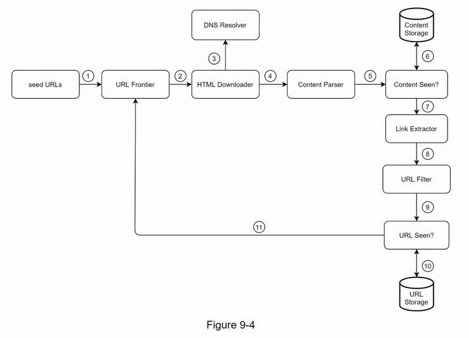
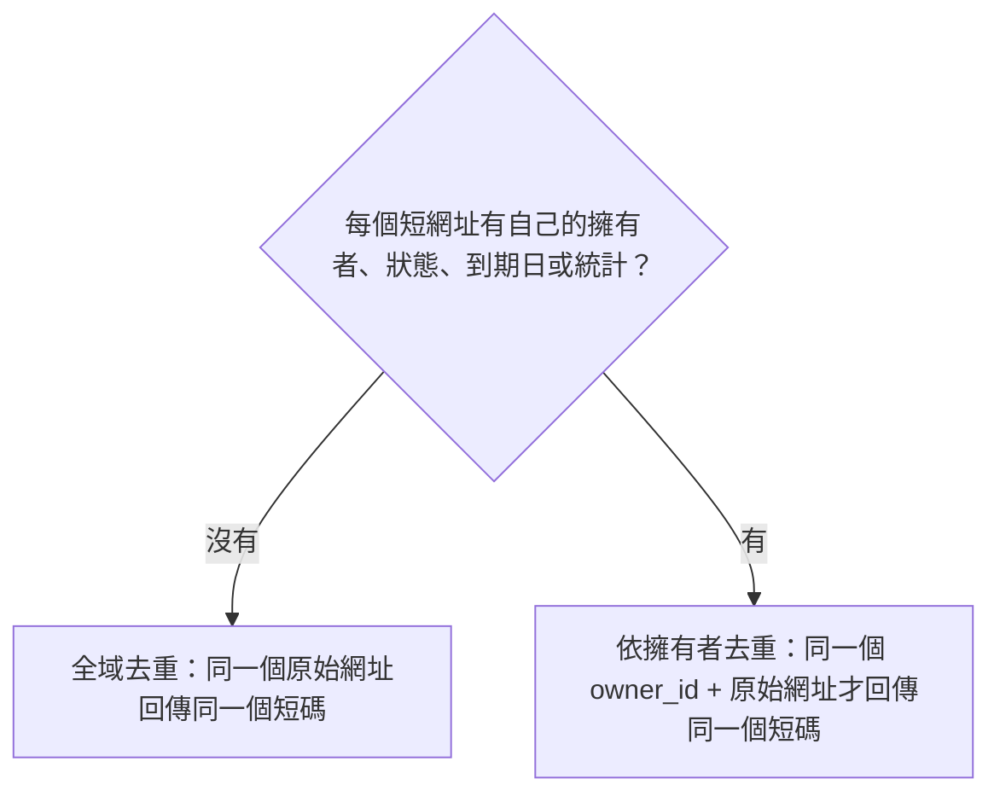
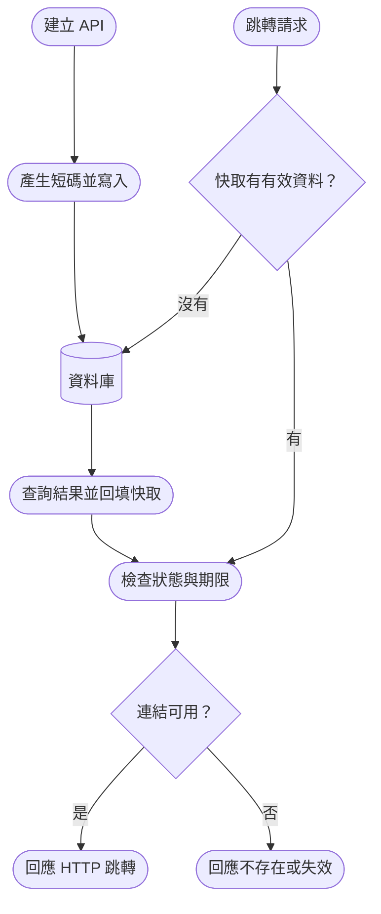
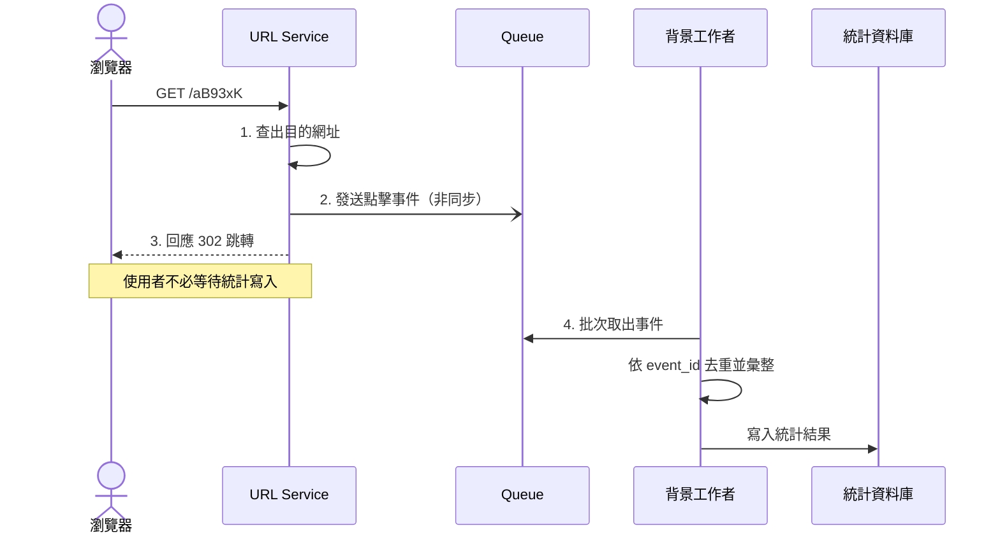
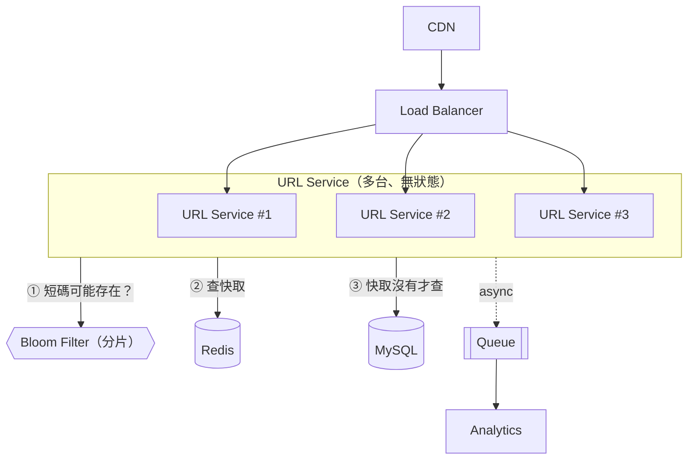

# [網路爬蟲系統設計](https://learning-guide.gitbook.io/system-design-interview/xi-tong-she-ji-mian-shi-nei-mu-zhi-nan-di-yi-juan/chapter-09-design-a-web-crawler)

## 1. 設計前的知識科普：

> 網路爬蟲（Web Crawler or Web Spider），是一種自動化程式或機器人，用來在網路上自動瀏覽網頁並收集資料，爬取內容可以是網頁、圖片、PDF、影片、JSON 等。許多網站會在根目錄設置 `robots.txt` 檔案，用來規範哪些頁面允許爬蟲訪問、哪些不行。

### 1.1 應用層面
* 搜尋引擎索引：Googlebot(Google 搜尋引擎背後的網路爬蟲)，最常見
* 網路監控：監控侵權行為
* 資料挖掘：在網路中爬取有用的知識，例如：租屋資訊、股東大會報告等
* 資料存取：有些國家圖書管會用爬蟲來存取網站，保存不同時間的版本，當成歷史文獻，供現在與未來的研究者使用

### 1.2 運作流程
1. 下載網頁
2. 找出連結
3. 把新網址加入待爬佇列



#### Seed URLs
種子 URL 是爬蟲的起點，一般是將整個 URL 空間拆成更小的空間，像是基於位置、主題(購物、體育、時尚、科技等)。

#### URL Frontier
爬行狀態：
1. 已下載
2. 待下載

#### HTML Downloader
#### DNS Resolver
#### Content Parser
#### Content Seen?
#### Content Storage
#### URL Extractor
#### URL Filter
#### URL Seen？
#### URL Storage


### 1.3 好的爬蟲基本樣貌
* 限制並行數，除了提升速度，也避免請求過多
* 失敗處理
* 只需進行最少的變更即可支援新的內容類型（可擴充性）
* 遵守爬取規範，像是 `robots.txt`、網站規範、請求頻率限制

## 2. 定義需求

> Q1. 爬蟲的主要目的是什麼？它用於搜尋引擎索引、資料探勘或其他用途嗎？
>
> A1: 搜尋引擎索引

> Q2. 網路爬蟲每個月收集多少網頁？
>
> A2: 10 億頁

> Q3. 內容包括哪些類型？
>
> A3: 只有 HTML

> Q4. 爬蟲抓過網站之後，還需要持續追蹤網站後來新增的頁面，以及舊頁面的內容更新嗎？
>
> A4: 是的，我們應該考慮新新增或編輯的網頁。

> Q4. 我們需要存爬取的 HTML 頁面嗎？
>
> A4: 是的，最多 5 年。

> Q4. 我們如何處理內容重複的網頁？
>
> A4: 重複內容的頁面應該忽略。


## 3. 粗估系統量級

> 目的：算出大概的流量與資料量，數量級對就好，並用結果推導設計決策

| 項目 | 假設 / 算式 | 結果 |
| ---- | ----------- | ---- |
| 讀取 QPS | 10 億 ÷ 30 ÷ 24 ÷ 3600 | 約 400 頁/秒 |
| 總筆數 | 跑 10 年 → 1 億 × 365 × 10 | 3,650 億筆 |
| 儲存空間 | 平均網頁大小為 500k → 10 億 × 500k | 500 TB/月, 3五年共 30 PB |
| 峰值 QPS | 讀取 QPS × 2～3 | 約 800 頁/秒 |

設計推導：

| 估算結果 | 設計決策 |
| -------- | -------- |
| 3,650 億筆 | 短碼長度：62⁶ ≈ 568 億不夠，62⁷ ≈ 3.5 兆 → **至少 7 碼** |
| 讀取尖峰約 3.5 萬次/秒 | 單台 DB 扛不住，需要快取（Redis）與讀取副本 |
| 寫入約 1,160 次/秒 | 單一 DB 可應付，但要注意 ID 產生器的速度 |
| 36.5 TB | 單台機器放不下，需要分片（sharding） |


## 4. DB Schema

| 欄位           | 用途                         |
| -------------- | ---------------------------- |
| `id`           | 系統內部識別碼               |
| `code`         | 對外短碼(Unique)                     |
| `original_url` | 跳轉目的地                   |
| `owner_id`     | 建立者；匿名服務可以允許空值 |
| `created_at`   | 建立時間                     |
| `expires_at`   | 到期時間；永久連結可以是空值 |
| `status`       | 啟用、停用、封鎖等狀態       |

## 6. 深入設計

<details>
  <summary>相同原始網址，要不要產生同一個短網址？</summary>
  因在「定義需求」區塊有提到，縮短後的 URL 不能被刪除或更新，代表沒有使用者的概念，所以做「全域去重」不會有問題，若服務允許匿名服務也是相同處理規則。

  PS. 全域去重：任何人送同一個網址都拿到相同短網址

  如果每個短網址都有自己的擁有者、狀態、到期日和點擊統計：
  > 可以依「擁有者」去重，同一個  `owner_id` 和 `original_url` 回傳同一個短網址，每人是獨立的。
  > - 雜湊法：改成對 `owner_id` + `original_url` 做雜湊
  > - Base62 / 隨機短碼：在 `(owner_id, url_hash)` 建唯一索引，建立前先查是否已存在



</details>

<details>
  <summary>已過期或停用的短網址，要不要重新使用？</summary>
  通常避免重用。舊短網址可能仍存在於訊息、QR Code 或印刷品中，重用後會把舊使用者導向另一個目的地。

</details>

<details>
  <summary>流量變大時，該怎麼處理？</summary>

短網址通常是寫入量 < 讀取量（短網址建立一次，但按鈕可以被點擊十萬次，就會有十萬次相同內容的查詢）

因此可以加入快取：



這種「先查快取，沒有才查資料庫」的模式稱為 Cache Aside

| 快取位置 | 快取內容 | 重要影響 |
|---|---|---|
| Redis | 短碼的查詢資料 | 使用者通常仍會經過你的服務 |
| 瀏覽器或 CDN | HTTP 跳轉回應 | 部分點擊可能不再抵達應用伺服器 |

#### Bloom Filter：擋掉不存在的短碼

Cache Aside 有個漏洞：查詢**根本不存在**的短碼時，快取一定沒有，每次都會直接打到資料庫，這稱為**快取穿透（Cache Penetration）**。

👉 解法：Bloom Filter 是一個很省空間的資料結構，用來快篩選「這個短碼是否存在」

Bloom Filter 也能用在**建立短網址**時：雜湊碰撞處理需要反覆檢查「短碼是否存在」，可以先問 Bloom Filter 就不必查資料庫


</details>

<details>
  <summary>點擊次數怎麼統計？</summary>

最直覺的做法是在每次跳轉時執行計數，但熱門連結會讓大量請求競爭同一筆資料，形成熱點 (hot key)。而且使用者只是要跳轉，如果還要等待統計寫入，會影響使用體驗。

較常見的擴充方式：
1. 查出目的網址
2. 發送一筆點擊事件到佇列或事件系統
3. 回應跳轉
4. 背景工作者批次儲存與彙整統計




**trade-off：跳轉優先，統計可以不完美**

| 情況 | 怎麼做 | 代價 |
| ---- | ------ | ---- |
| Queue 掛了，點擊事件送不出去 | 照樣跳轉 | 少算幾次點擊 |
| 沒收到確認，同一個事件又送了一次 | 每個事件帶 `event_id`，同一個 id 只算一次 | 多存一個欄位 |
| 點擊後，後台數字沒有馬上更新 | 接受延遲幾秒，背景批次處理 | 數字不是即時的 |

**一次請求 ≠ 一個人點擊**

連結貼到 LINE / Slack 時，平台會先自動打開連結產生預覽；搜尋引擎、掃描器、機器人也會打開。所以要分清楚三種數字：

| 指標 | 算法 |
| ---- | ---- |
| 請求次數 | 所有請求都算 |
| 人類點擊 | 扣掉機器人 |
| 不重複使用者 | 同一個人點多次只算 1 次 |

**怎麼判斷是不是機器人？**

`user_agent` 可以偽造，只擋得住會自報身份的機器人（LINE 預覽、Googlebot）。如果是偽裝成一般瀏覽器的腳本，需要搭配其他指標來看：

| 指標 | 情況 |
| ---- | ---------- |
| IP 來源 | 來自雲端機房（AWS、GCP），不是家用或行動網路 |
| 頻率 | 同一個 IP 短時間有大量點擊 |
| 反向 DNS | 自稱 Googlebot，但 IP 不屬於 `googlebot.com` |
| 行為 | 短網址剛建立一兩秒內就被請求，或用 `HEAD` 而不是 `GET`（瀏覽器點連結一定用 GET） |

**點擊事件要記錄的內容**

```jsonc
{
  "event_id": "...",                     // 事件編號，用來去除重複
  "link_id": "aB93xK",                   // 哪個短網址被點
  "clicked_at": "2026-10-05T02:00:00Z",  // 點擊時間，用來做時間統計
  "referer": "https://example.org/",     // 從哪個頁面點進來（選填）
  "user_agent": "..."                    // 瀏覽器資訊，用來判斷是否為機器人（選填）
}
```
</details>

## 7. 完整架構



跳轉請求依 ① → ② → ③ 的順序查詢：Bloom Filter 判斷「一定不存在」就直接回應 404，不會查到 Redis 與 MySQL。建立短網址時，寫入 MySQL 後也要把短碼加進 Bloom Filter。

